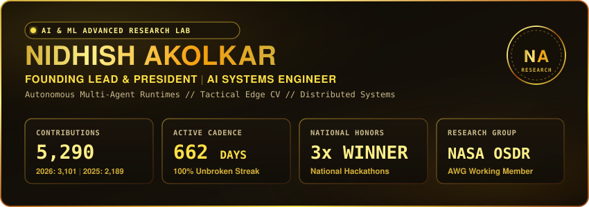

  

### ⚡ Flagship Systems & Architectures

<table>
  <tr>
    <td width="50%" valign="top">
      <h4><a href="https://github.com/nidhishakolkar01-lgtm/Jarvis-Architecture">🤖 Jarvis-Architecture</a></h4>
      
Modular multi-agent AI operating platform with self-healing execution graphs &amp; deterministic state-rollback boundaries.

      
      
      
      
    </td>
    <td width="50%" valign="top">
      <h4><a href="https://github.com/nidhishakolkar01-lgtm/DeepVani">🗣️ DeepVani</a></h4>
      
Silent speech decoder converting real-time lip kinematics (468 landmarks) to natural audio via TCN classifiers.

      
      
      
      
    </td>
  </tr>
  <tr>
    <td width="50%" valign="top">
      <h4><a href="https://github.com/nidhishakolkar01-lgtm/TRINETRA-C2">🎯 TRINETRA-C2</a></h4>
      
Tactical edge surveillance platform with multi-camera ReID, offline acoustic routing, and &gt;94% false alarm reduction.

      
      
      
      
    </td>
    <td width="50%" valign="top">
      <h4><a href="https://github.com/nidhishakolkar01-lgtm/ASTRA-C4I">🛡️ ASTRA-C4I</a></h4>
      
Counter-UAS threat simulation and synthetic radar telemetry platform with electronic warfare inject engines.

      
      
      
      
    </td>
  </tr>
  <tr>
    <td width="50%" valign="top">
      <h4><a href="https://github.com/nidhishakolkar01-lgtm/Project-Sentinel">🛰️ Project-Sentinel</a></h4>
      
Distributed video management system (VMS) with edge stream multiplexing and real-time GIS spatial tracking.

      
      
      
      
    </td>
    <td width="50%" valign="top">
      <h4><a href="https://github.com/nidhishakolkar01-lgtm/Mobile-Hygiene-Guardian">🔒 Mobile-Hygiene-Guardian</a></h4>
      
Zero-trust automated security auditor for Android analyzing APK attack surfaces and excessive permissions.

      
      
      
      
    </td>
  </tr>
</table>

### 🏆 Honors, Appointments & Research

<table>
  <tr>
    <td width="5%" align="center">🥇</td>
    <td><b>3x National Hackathon Winner</b> — Secured top podium finishes across competitive national-scale AI &amp; systems engineering hackathons.</td>
  </tr>
  <tr>
    <td width="5%" align="center">🧬</td>
    <td><b>NASA OSDR Analysis Working Group (AWG)</b> — Active member collaborating on open space biological &amp; multi-omics data workflows.</td>
  </tr>
  <tr>
    <td width="5%" align="center">👑</td>
    <td><b>Founding Lead &amp; President</b> — AI &amp; ML Advanced Research Lab, directing engineering on autonomous edge intelligence.</td>
  </tr>
  <tr>
    <td width="5%" align="center">✍️</td>
    <td><b>Technical Author</b> — In-depth architectural case studies &amp; systems engineering papers published on Dev.to and Medium.</td>
  </tr>
</table>

 

  
  
  
  
  

